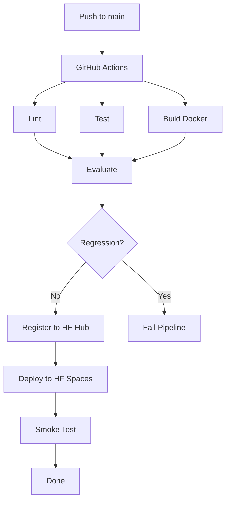

# CheckYourCrop

An MLOps pipeline for crop vs weed detection using YOLOv8.

## What This Proves

This project demonstrates a complete, production-ready MLOps pipeline on free infrastructure:

- **Model serving**: FastAPI + ultralytics/ONNX, Dockerized for Hugging Face Spaces (free CPU)
- **Model registry**: Hugging Face Hub (versioned weights + metrics)
- **Evaluation gate**: Automated regression detection on held-out golden set
- **CI/CD**: GitHub Actions orchestrating lint, test, build, evaluate, register, deploy, smoke
- **Zero cost**: GitHub public repo + GitHub Actions + HF Hub + HF Spaces (no cloud credits, no Kubernetes, no paid tiers)

## Architecture



## Repository Layout

```
checkyourcrop/
├── app/                      # FastAPI application
│   ├── __init__.py           # Version
│   ├── config.py             # Environment-driven settings
│   ├── inference.py          # Letterbox, NMS, parsing, annotation, verdict
│   ├── ratelimit.py          # Per-IP sliding window
│   ├── main.py               # FastAPI routes + lifespan
│   └── static/
│       └── index.html        # Upload page (inline CSS/JS, no CDN)
├── scripts/
│   ├── evaluate.py           # Evaluation gate (ultralytics val + baseline compare)
│   └── pipeline.py           # All stages: lint,test,build,evaluate,register,deploy,smoke
├── tests/
│   ├── conftest.py           # Fixtures (fake detector, no weights needed)
│   ├── test_inference.py     # Postprocessing + verdict unit tests
│   ├── test_api.py           # Endpoint tests with fake detector
│   └── test_ratelimit.py     # Rate limiter tests
├── eval/golden/              # Held-out evaluation set
│   ├── data.yaml             # Dataset config
│   └── README.md             # Setup instructions
├── data.yaml                 # Training dataset config (doc only)
├── Dockerfile                # python:3.12-slim, CPU torch, uid 1000
├── requirements.txt          # Production deps
├── requirements-dev.txt      # Dev deps (pytest, ruff, onnxruntime)
├── pyproject.toml            # Ruff + pytest config
├── .env.example              # Environment template
├── .gitignore                # Ignores weights, data, outputs
├── Makefile                  # Local commands
└── .github/workflows/mlops.yml
```

## Local Development

### Prerequisites

- Python 3.11+
- Docker (optional, for build stage)

### Setup

```bash
# Create virtual environment
python -m venv venv
source venv/bin/activate

# Install dependencies
pip install -r requirements-dev.txt

# Copy environment template
cp .env.example .env
# Edit .env if needed (MODEL_PATH, etc.)

# Run tests
make test

# Run linter
make lint

# Run API server
make run
# Open http://localhost:7860
```

### Run Pipeline Stages Locally

```bash
# Full pipeline (requires HF_TOKEN, HF_MODEL_REPO, HF_SPACE, SERVICE_URL)
make pipeline

# Individual stages
make evaluate
make register
make deploy
make smoke
```

## Evaluation Gate

The evaluation gate (`scripts/evaluate.py`) prevents model regression:

1. Runs `ultralytics YOLO.val()` on `eval/golden/` (held-out test slice)
2. Computes map50_95, map50, precision, recall
3. Compares map50_95 against baseline (from `outputs/baseline_metrics.json`)
4. Fails if drop exceeds tolerance (default 0.015)

Exit codes:
- `0` PASS: No significant regression
- `1` FAIL: Regression detected (drop > tolerance)
- `2` SKIP: Cannot evaluate (missing weights, data, baseline, or ultralytics)

### Setting Up the Golden Set

```bash
# 1. Split your dataset into train/val/test
# 2. Copy ~50 images + labels from TEST split to:
mkdir -p eval/golden/images/val
cp /path/to/test/images/* eval/golden/images/val/
cp /path/to/test/labels/* eval/golden/images/val/

# 3. Record baseline after initial training:
#    Run validation on test set, note map50_95
#    Create outputs/baseline_metrics.json:
cat > outputs/baseline_metrics.json <<'EOF'
{
  "map50_95": 0.7234,
  "map50": 0.8912,
  "precision": 0.78,
  "recall": 0.71,
  "split": "test",
  "model": "best.pt",
  "timestamp": "2026-01-15T10:30:00Z"
}
EOF
```

## Deploy Runbook

### 1. Create GitHub Repository

```bash
git init
git add .
git commit -m "Initial commit"
gh repo create YOURNAME/checkyourcrop --public --source=. --push
```

### 2. Create Hugging Face Model Repository

```bash
hf repo create YOURNAME/checkyourcrop-model --type model
```

### 3. Create Hugging Face Space

```bash
hf repo create YOURNAME/checkyourcrop --type space --space-sdk docker
```

### 4. Upload Initial Weights and Baseline Metrics

```bash
# Upload model weights
hf upload YOURNAME/checkyourcrop-model best_kd_student_deployable.pt best.pt

# Upload baseline metrics (after recording from your test set)
hf upload YOURNAME/checkyourcrop-model outputs/baseline_metrics.json metrics.json
```

### 5. Set GitHub Secrets and Variables

```bash
# Secret: HF_TOKEN (write token from huggingface.co/settings/tokens)
gh secret set HF_TOKEN --body "hf_xxxxxxxxxxxx"

# Variables
gh variable set HF_MODEL_REPO --body "YOURNAME/checkyourcrop-model"
gh variable set HF_SPACE --body "YOURNAME/checkyourcrop"
gh variable set SERVICE_URL --body "https://YOURNAME-checkyourcrop.hf.space"
```

### 6. Push to Trigger Pipeline

```bash
git push origin main
```

The first pipeline run will show `evaluate: SKIP` until `eval/golden/images/val/` contains ~50 images from your test split. This is expected, not a failure.

## API Contract

### GET /
Returns the upload page (HTML).

### GET /healthz
```json
{
  "status": "ok",
  "version": "0.1.0",
  "model_loaded": true
}
```

### GET /api/model
```json
{
  "backend": "ultralytics",
  "class_names": { "0": "Waterhemp", ... },
  "registry_source": "YOURNAME/checkyourcrop-model",
  "confidence_threshold": 0.25,
  "iou_threshold": 0.45
}
```

### POST /api/predict
Multipart form with `file` (image).

Response:
```json
{
  "verdict": "weed",
  "counts": { "crop": 0, "weed": 3, "other": 0 },
  "detections": [
    { "class_id": 4, "class_name": "Carpetweed", "confidence": 0.92, "bbox": [100, 100, 200, 200] }
  ],
  "inference_ms": 45.2,
  "model_source": "models/best.pt",
  "annotated_image": "data:image/png;base64,..."
}
```

Error responses:
- `400` Invalid image bytes
- `413` File > 10 MB
- `415` Non-image content type
- `429` Rate limit exceeded (20 req/min/IP)
- `503` Model not loaded
- `500` Inference error

## Model Limitations

- **Weed-only detector**: The checkpoint contains 19 weed classes, no crop classes
- **Class mapping**: Only classes containing "weed" substring (Carpetweed, Ragweed, OtherWeed) map to "weed" group; all others map to "other"
- **Input size**: 640x640 (letterboxed with padding)
- **Confidence threshold**: 0.25 default, adjustable via `CONFIDENCE_THRESHOLD`
- **No crop detection**: Cannot distinguish crops from background; verdict "crop" will never occur with current weights
- **Geographic bias**: Trained on specific weed species; may not generalize to other regions

## Resume Bullets

- Designed and implemented a full MLOps pipeline (CI/CD, model registry, evaluation gate, canary deploy) on free tier GitHub Actions + Hugging Face Hub/Spaces with zero cloud spend
- Built production-grade FastAPI inference service with letterbox preprocessing, numpy NMS, ONNX/PT dual backend, per-IP rate limiting, and base64 annotated responses
- Created automated regression gate comparing map50_95 against baseline on held-out golden set, blocking deploy on >1.5% drop with clear SKIP/FAIL/PASS semantics# Trigger workflow
# Updated Fly.io token
# Updated Fly.io token
